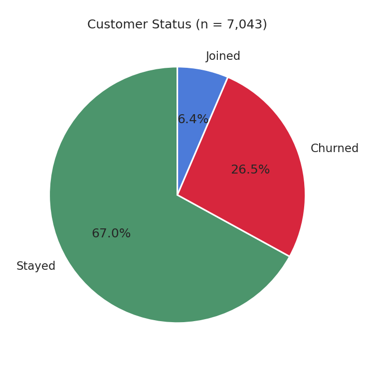
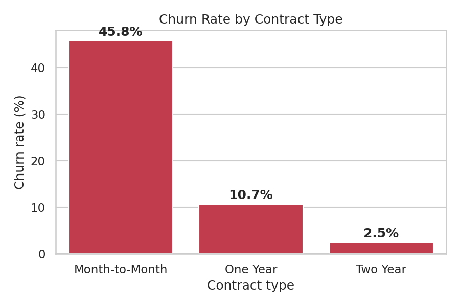
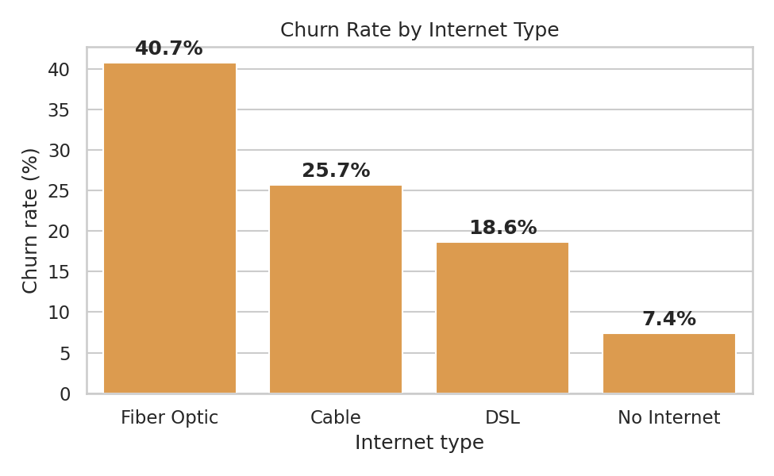
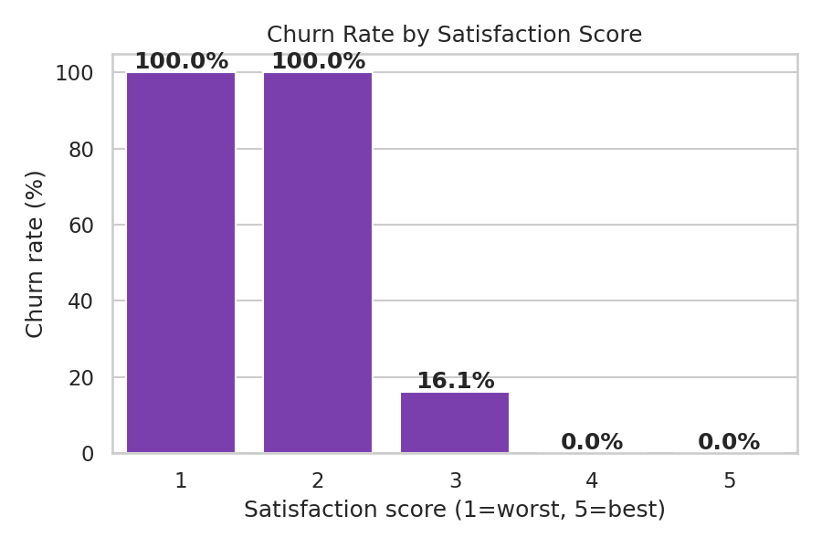
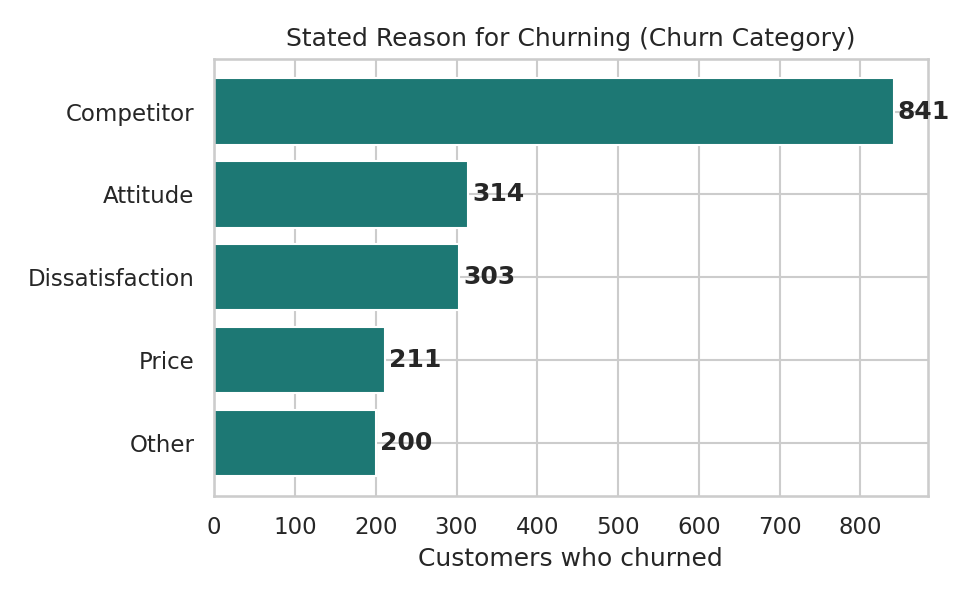
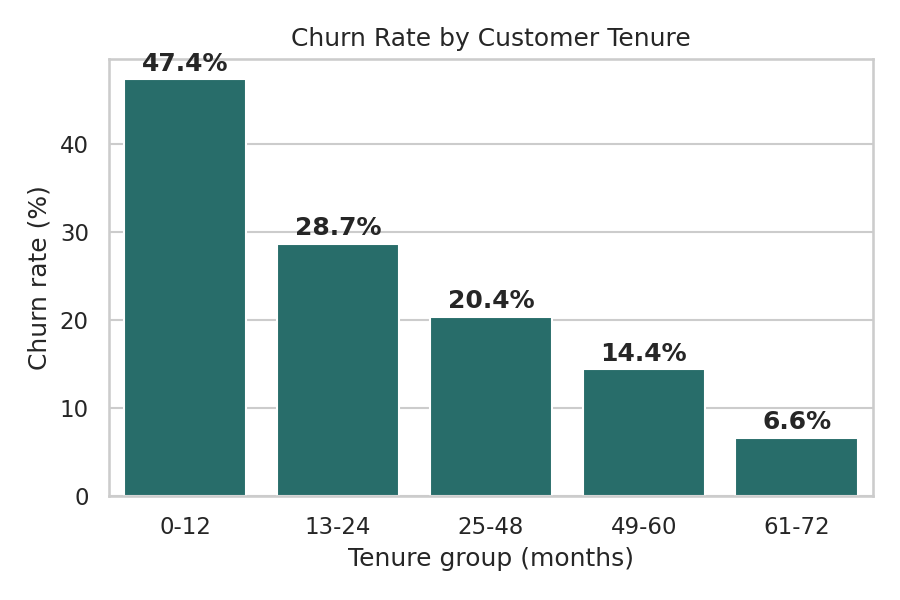
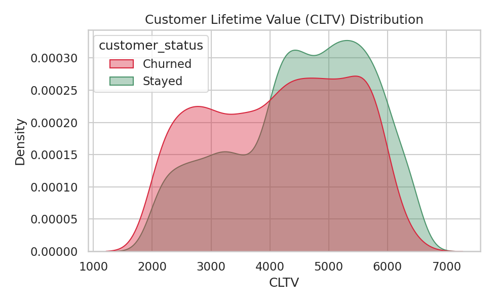
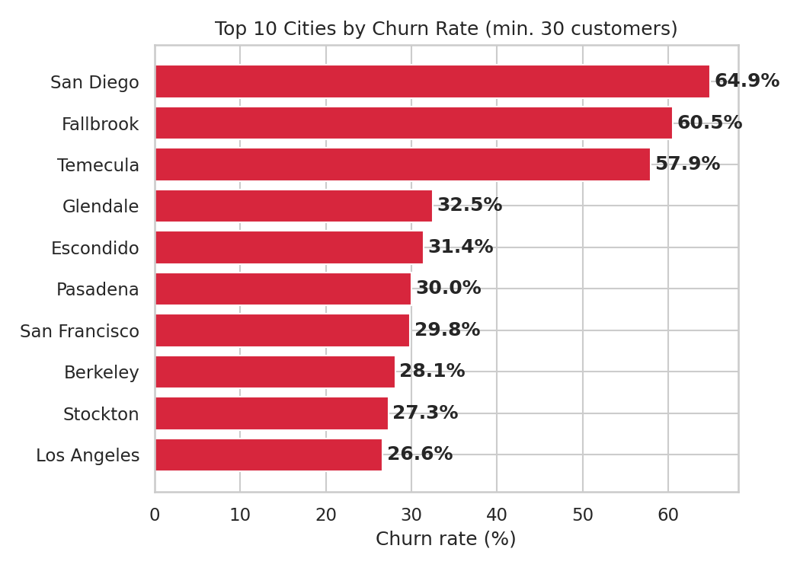
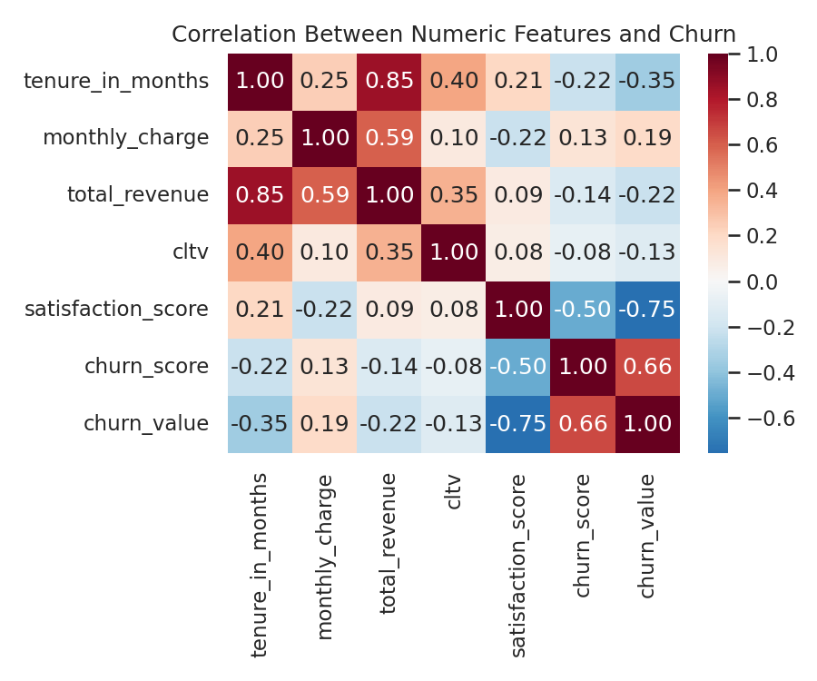

# 📊 Telco Customer Churn Analysis

A SQL + Python data analysis project exploring why customers churn for a fictional California
telecom company, built the way a **Data Analyst** would work with real relational source data.

**Dataset:** [Telco Customer Churn (11.1.3+)](https://www.kaggle.com/datasets/ylchang/telco-customer-churn-1113) — IBM Cognos Analytics sample dataset, 7,043 customers, 5 relational tables

---

## Table of contents

1. [Project Overview](#1-project-overview)
2. [Source Data](#2-source-data)
3. [Project Structure](#3-project-structure)
4. [How to Run](#4-how-to-run)
5. [Methodology](#5-methodology)
6. [Visuals & Insights](#6-visuals--insights)
7. [Key Findings](#7-key-findings)
8. [Recommendations](#8-recommendations)
9. [Tools Used](#9-tools-used)

---

## 1. Project Overview

This project analyzes one quarter of customer data to answer a single business question:

> **Who is churning, and why — and what should the company do about it?**

The workflow mirrors a real analyst pipeline: raw relational files are loaded into a **SQL
database**, cleaned, joined into one analysis table, then explored with SQL queries and
visualizations to surface actionable drivers of churn.

**Headline numbers:**

| Metric | Value |
|---|---|
| Total customers | 7,043 |
| Churned | 1,869 (26.5%) |
| Stayed | 4,720 (67.0%) |
| New joins | 454 (6.4%) |

---

## 2. Source Data

Unlike the more common single-file mirror of this dataset seen online, the real Kaggle download
ships as **5 separate relational tables**:

| File | Grain | Contents |
|---|---|---|
| `Telco_customer_churn_demographics.xlsx` | 1 row / customer | Gender, age, marital status, dependents |
| `Telco_customer_churn_location.xlsx` | 1 row / customer | Country, state, city, zip code, latitude/longitude |
| `Telco_customer_churn_population.xlsx` | 1 row / zip code | Population estimate per zip |
| `Telco_customer_churn_services.xlsx` | 1 row / customer | Services subscribed, contract, billing, revenue |
| `Telco_customer_churn_status.xlsx` | 1 row / customer | Satisfaction score, churn label/score, CLTV, churn reason |

These are joined on `Customer ID` (and `Zip Code` for population) into a single 7,043-row table,
`customers_clean`, which is the foundation for every query and chart below.

---

## 3. Project Structure

```
telco_churn_project/
├── data/
│   ├── raw/
│   │   ├── Telco_customer_churn_demographics.xlsx    # original files, untouched
│   │   ├── Telco_customer_churn_location.xlsx
│   │   ├── Telco_customer_churn_population.xlsx
│   │   ├── Telco_customer_churn_services.xlsx
│   │   └── Telco_customer_churn_status.xlsx
│   └── processed/
│       └── telco_churn_clean.csv                     # cleaned, joined, analysis-ready dataset
├── db/
│   └── telco_churn.db                                 # SQLite DB: 5 raw tables + customers_clean
├── notebooks/
│   └── churn_analysis.ipynb                            # full, executed analysis notebook
├── visuals/
│   ├── 01_customer_status_distribution.png
│   ├── 02_churn_by_contract.png
│   ├── 03_churn_by_internet_type.png
│   ├── 04_churn_by_satisfaction_score.png
│   ├── 05_churn_reasons.png
│   ├── 06_churn_by_tenure_group.png
│   ├── 07_cltv_distribution.png
│   ├── 08_top_churn_cities.png
│   └── 09_correlation_heatmap.png
├── requirements.txt
└── README.md
```

---

## 4. How to Run

```bash
# 1. Install dependencies
pip install -r requirements.txt

# 2. Launch the notebook
jupyter notebook notebooks/churn_analysis.ipynb
```

Running the notebook top to bottom regenerates `db/telco_churn.db`,
`data/processed/telco_churn_clean.csv`, and every PNG in `visuals/` directly from the 5 raw
Excel files — the whole pipeline is fully reproducible.

---

## 5. Methodology

| Step | What happens |
|---|---|
| **1. Load** | Read all 5 Excel files and load each one as-is into its own SQLite table (`raw_demographics`, `raw_location`, `raw_population`, `raw_services`, `raw_status`) |
| **2. Profile** | Check each table for nulls and duplicate `Customer ID`s. Several "nulls" are structural, not errors — e.g. no `Offer` means no promotion was taken, no `Churn Reason` means the customer didn't churn |
| **3. Clean** | Fill structural nulls with explicit labels, standardize column names to `snake_case`, add a `tenure_group` bucket (0-12, 13-24, 25-48, 49-60, 61-72 months) |
| **4. Join** | Merge `services` + `demographics` + `location` + `status` on `Customer ID`, then join `population` in via `Zip Code` → one row per customer |
| **5. Persist** | Save the joined table to `data/processed/telco_churn_clean.csv` and to a `customers_clean` table in SQLite |
| **6. Analyze** | Run SQL `SELECT`/`GROUP BY` queries against `customers_clean` for every business question below |
| **7. Visualize** | Generate 9 matplotlib/seaborn charts, each saved to `visuals/` |

---

## 6. Visuals & Insights

### 6.1 Customer Status Distribution


**67.0% stayed, 26.5% churned, 6.4% are new joins.** A churn rate near 1 in 4 is high for a
subscription business — every other chart below tries to explain what's driving it.

### 6.2 Churn Rate by Contract Type


Month-to-month customers churn at **45.8%**, versus **10.7%** on one-year and just **2.5%** on
two-year contracts. Contract length is one of the biggest levers the company has over churn.

### 6.3 Churn Rate by Internet Type


Fiber optic customers churn at **40.7%** — well above cable (25.7%), DSL (18.6%), and customers
with no internet at all (7.4%). Points to either premium-price sensitivity or service quality
issues specific to fiber.

### 6.4 Churn Rate by Satisfaction Score


The standout finding of the whole analysis: **100% of customers rating satisfaction 1 or 2
churned**, dropping to **16.1% at a score of 3**, and **0% churned at 4 or 5**. Satisfaction Score
correlates with churn at **-0.75** — by far the strongest relationship in the dataset.

### 6.5 Stated Reasons for Churning


Among the 1,869 churned customers: **Competitor (841)**, **Attitude (314)**,
**Dissatisfaction (303)**, **Price (211)**, **Other (200)**. Losing customers to competitors is
more than double the next closest reason.

### 6.6 Churn Rate by Tenure Group


Churn falls steadily with tenure: **47.4%** (0-12 months) → **28.7%** (13-24) → **20.4%** (25-48)
→ **14.4%** (49-60) → **6.6%** (61-72). The first year is clearly the highest-risk window
(correlation: -0.35).

### 6.7 CLTV Distribution — Churned vs. Retained


Retained customers average **CLTV 4,530**, **$3,736** total revenue, and **41 months** tenure.
Churned customers average **CLTV 4,149**, **$1,971** total revenue, and just **18 months** tenure —
lower value on average, but still a meaningful loss of long-tenured accounts.

### 6.8 Top 10 Cities by Churn Rate


Churn is geographically concentrated: **San Diego (64.9%, n=285)** and **Fallbrook (60.5%, n=43)**
sit dramatically above the 26.5% company average, followed by Temecula (57.9%), Glendale (32.5%),
and Escondido (31.4%).

### 6.9 Correlation Heatmap


**Satisfaction Score (-0.75)** and **Churn Score (+0.66)** are by far the strongest correlates of
churn, followed by tenure (-0.35), total revenue (-0.22), monthly charge (+0.19), and CLTV (-0.13).

---

## 7. Key Findings

- **26.5% of customers churned** this quarter (1,869 of 7,043).
- **Satisfaction Score is an almost perfect predictor of churn** — 100% churn at scores 1-2, 0%
  churn at scores 4-5, and the strongest correlation (-0.75) of any variable.
- **"Competitor" is the #1 stated reason for leaving** (841 of 1,869 churned customers).
- **Contract type is a major lever** — month-to-month churn (45.8%) is nearly 18x higher than
  two-year contracts (2.5%).
- **Fiber optic customers churn the most** (40.7%) among internet types.
- **Churned customers skew lower-value**, but the company still loses meaningful high-tenure,
  high-CLTV accounts.
- **Churn is geographically concentrated** in San Diego, Fallbrook, and Temecula.
- **The first 12 months is the highest-risk window** for churn (47.4%).

---

## 8. Recommendations

1. **Operationalize Satisfaction Score as a real-time early-warning system** — trigger proactive
   outreach the moment a customer scores 1-2.
2. **Investigate "Competitor" churn directly** with win-back offers, competitive plan matching,
   and structured exit interviews.
3. **Incentivize month-to-month customers to move to longer contracts** through discounts or
   loyalty perks.
4. **Audit fiber optic service quality and pricing**, given its outsized churn rate.
5. **Run localized retention campaigns in San Diego, Fallbrook, and Temecula.**
6. **Focus onboarding and early support in a customer's first 12 months**, when churn risk peaks.

---

## 9. Tools Used

| Tool | Purpose |
|---|---|
| **SQLite3** | Structured multi-table storage, SQL joins and aggregation |
| **pandas / numpy** | Cleaning, standardizing, and merging the 5 source tables |
| **matplotlib / seaborn** | Visualization |
| **Jupyter Notebook** | Tying the workflow together with narrative markdown |
